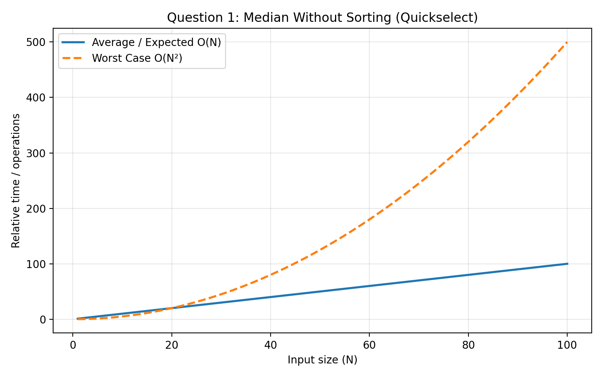

# DAA Lab-5: Finding Median Without Sorting

## Problem Statement

Write a C program to find the median of `N` elements without sorting the
complete list.

## Algorithm Used

**Quick Select Algorithm**

Quick Select works similarly to Quick Sort partitioning. However, it
searches only the part of the array that contains the required median.

## How It Works

1.  Choose a pivot element.
2.  Partition the array around the pivot.
3.  If the pivot is at the median position, return it.
4.  Otherwise, continue searching in the required partition.

### Median Position

-   For odd `N`: median index = `N / 2`
-   For even `N`: median is the average of the elements at indices
    `N/2 - 1` and `N/2`

## Time Complexity

  Case                 Complexity
  -------------------- ------------
  Average / Expected   **O(N)**
  Worst                **O(N²)**

## Complexity Graph



## Compilation

``` bash
gcc Q1_Median.c -o median
./median
```

## Concepts Used

-   Quick Select
-   Partitioning
-   Recursion
-   Divide and Conquer

## Author

**Sonu Kumar**\
B.Tech CSE
