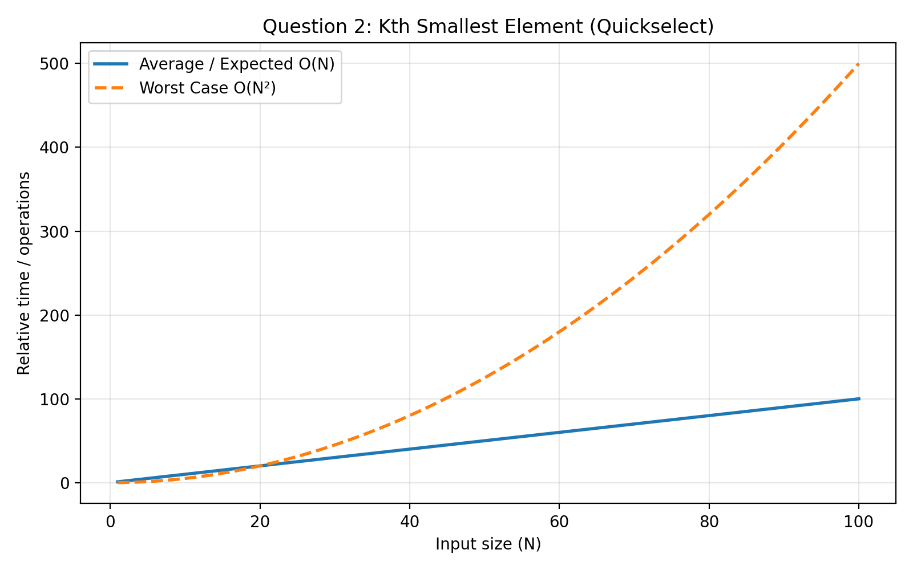

#  Kth Smallest Element Without Sorting

## Problem Statement

Write a C program to find the `K`th smallest element in an array without
sorting the complete array.

## Algorithm Used

**Quick Select Algorithm**

Quick Select finds an element at a particular position without
completely sorting the array.

## How It Works

1.  Choose a pivot element.
2.  Partition the array around the pivot.
3.  Compare the pivot position with `K - 1`.
4.  Search only the required partition.
5.  Return the element when the pivot reaches the required position.

> `K - 1` is used because array indexing starts from 0.

## Time Complexity

  Case                 Complexity
  -------------------- ------------
  Average / Expected   **O(N)**
  Worst                **O(N²)**

## Complexity Graph



## Compilation

``` bash
gcc Q2.c -o kthsmallest
./kthsmallest
```

## Concepts Used

-   Quick Select
-   Partitioning
-   Recursion
-   Divide and Conquer

