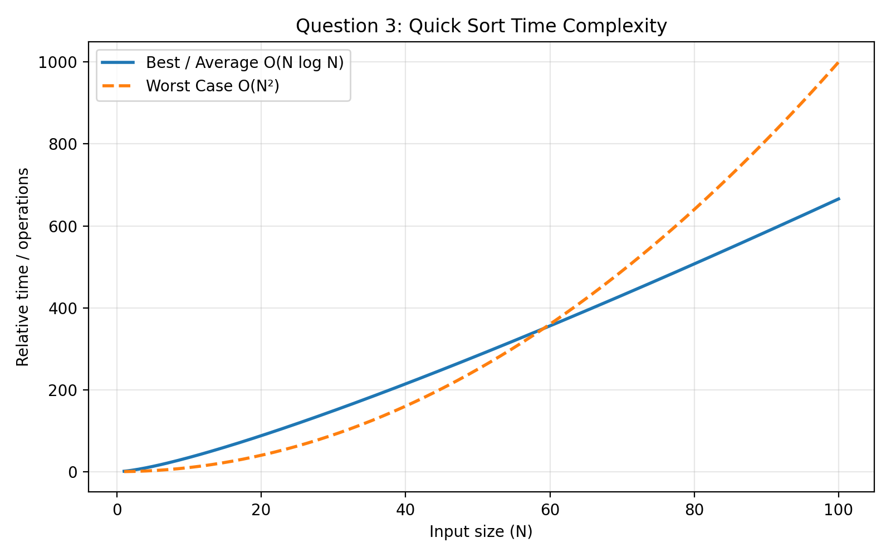

#  Quick Sort of Random Elements Stored in a File

## Problem Statement

Generate `N` random elements, store them in a file, read them from the
file, and sort them using Quick Sort.

## Working

1.  Accept the number of elements `N`.
2.  Generate `N` random numbers.
3.  Store the numbers in `input.txt`.
4.  Read the numbers from the file.
5.  Apply Quick Sort.
6.  Store the sorted numbers in `output.txt`.

## Random Number Generation

``` c
srand(time(NULL));
```

This initializes the pseudo-random number generator using the current
system time as a seed.

``` c
int num = rand() % 1000;
```

This generates a pseudo-random number in the range:

``` text
0 to 999
```

## Algorithm Used

**Quick Sort**

Quick Sort: 1. Selects a pivot. 2. Partitions elements around the pivot.
3. Recursively sorts the left partition. 4. Recursively sorts the right
partition.

## Time Complexity

  Case      Complexity
  --------- ----------------
  Best      **O(N log N)**
  Average   **O(N log N)**
  Worst     **O(N²)**

## Complexity Graph



## Compilation

``` bash
gcc Q3.c -o quicksort
./quicksort
```

## Files Generated

-   `input.txt` --- Contains randomly generated numbers.
-   `output.txt` --- Contains sorted numbers.

## Concepts Used

-   Quick Sort
-   Divide and Conquer
-   Recursion
-   File Handling
-   Random Number Generation


