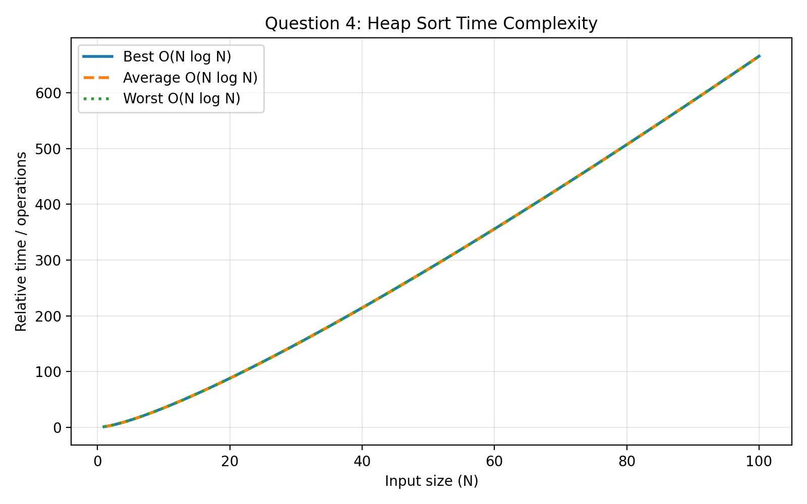

#  Heap Sort of Random Elements Stored in a File

## Problem Statement

Generate `N` random elements, store them in a file, read them from the
file, and sort them using Heap Sort.

## Working

1.  Accept the number of elements `N`.
2.  Generate `N` random numbers.
3.  Store the numbers in `heap_input.txt`.
4.  Read the elements from the file.
5.  Build a Max Heap.
6.  Apply Heap Sort.
7.  Store the sorted elements in `heap_output.txt`.

## Random Number Generation

``` c
srand(time(NULL));
```

This initializes the pseudo-random number generator using the current
system time.

``` c
int num = rand() % 1000;
```

This generates numbers from:

``` text
0 to 999
```

## Algorithm Used

**Heap Sort**

Heap Sort first creates a **Max Heap**.

Then: 1. The largest element is placed at the root. 2. The root is
exchanged with the last element. 3. The heap size is reduced. 4. Heapify
is performed again. 5. The process continues until the array is sorted.

## Time Complexity

  Case      Complexity
  --------- ----------------
  Best      **O(N log N)**
  Average   **O(N log N)**
  Worst     **O(N log N)**

## Space Complexity

**O(1)** auxiliary space.

## Complexity Graph



## Compilation

``` bash
gcc Q4.c -o heapsort
./heapsort
```

## Files Generated

-   `heap_input.txt` --- Contains randomly generated numbers.
-   `heap_output.txt` --- Contains sorted numbers.

## Concepts Used

-   Heap Sort
-   Max Heap
-   Heapify
-   File Handling
-   Random Number Generation


